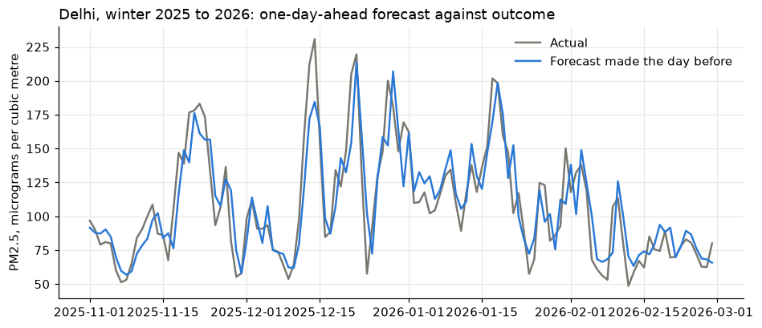

# Next-day air quality forecasts for ten major cities

A live PM2.5 forecast for ten cities in Africa, Asia and Latin America, from a model trained on four years of Copernicus data.

**[Open the Streamlit app](https://urban-air-quality-forecast-5w3azvwevcf9chmpkgm7bv.streamlit.app/)** · **[Open the web dashboard](https://chiamaka-uchenna.github.io/urban-air-quality-forecast/)** · **[Read the notebook](notebooks/air_quality_forecast.ipynb)**



## The problem

Fine particulate matter (PM2.5) does more damage to human health than any other air pollutant, and the WHO attributes millions of premature deaths a year to outdoor air pollution. Many fast-growing cities exceed the WHO guideline many times over and have few ground monitors. A next-day forecast lets schools, hospitals and people with heart or lung disease plan around the worst days.

## Data

Hourly PM2.5 from the Copernicus Atmosphere Monitoring Service (CAMS) global analysis and daily weather from the ECMWF ERA5 reanalysis, both through the open [Open-Meteo API](https://open-meteo.com/) (CC BY 4.0). 374,640 hourly values for ten cities, August 2022 to November 2026.

The notebook downloads the data itself the first time it runs and caches it in `data/raw/`, so nothing needs to be downloaded by hand.

## Key results

- All ten cities exceed the WHO annual guideline of 5 µg/m³. Delhi, Lahore and Jakarta average 13 to 15 times the guideline.
- Pollution is strongly seasonal, and the season depends on geography: winter in South Asia, the Harmattan months in West Africa, the dry season south of the equator.
- On a full year the model never saw, the forecast error is 17% lower than assuming tomorrow equals today (mean error 6.6 against 7.9 µg/m³, R squared 0.91 against 0.87).
- The gain is 15% to 20% in eight cities, 7% in Nairobi, and nil in Accra, the cleanest city.
- As a warning for each city's worst quarter of days, the model is only slightly better than persistence (74% of high days caught against 73%, 76% of warnings correct against 73%). The notebook says so plainly.

## Approach

1. Automated download with retries and caching, daily aggregation in local time
2. Comparison with WHO guidelines, seasonality and weather effects
3. Features from recent pollution, today's and tomorrow's weather, season and weekday
4. Strict time-based split with a 12-month held-out test year, compared with persistence and a seven-day average
5. Evaluation as a warning system, empirical prediction interval with a coverage check
6. The dashboard fetches live data and runs the model in the browser

Every step is explained in the notebook, with the reasoning behind each decision.

## Live dashboard

The dashboard is a static page served by GitHub Pages from the `docs/` folder. The trained model is exported from the notebook as JSON and scored in the browser with a few lines of JavaScript, so there is no server to maintain. The notebook checks that the exported model reproduces the original predictions before writing the file.

## Streamlit app

The same model and charts are deployed as a Streamlit app on Streamlit Community Cloud: [https://urban-air-quality-forecast-5w3azvwevcf9chmpkgm7bv.streamlit.app/](https://urban-air-quality-forecast-5w3azvwevcf9chmpkgm7bv.streamlit.app/). If the app has been idle it takes a few seconds to wake up. The code is in `app/`. To run it locally:

```bash
pip install -r app/requirements.txt
streamlit run app/streamlit_app.py
```

`app/common.py` contains the scoring code: it loads the exported trees and reproduces the model's predictions in plain Python.

## Repository layout

```
notebooks/air_quality_forecast.ipynb   the full analysis, with outputs
scripts/air_quality_forecast.py   the same pipeline as a plain Python script
app/                        Streamlit app (streamlit_app.py, common.py, requirements.txt)
docs/                       the static dashboard served by GitHub Pages
data/                       raw data is downloaded here by the notebook (not committed)
requirements.txt            Python dependencies for the notebook
```

## Run it yourself

```bash
git clone https://github.com/Chiamaka-Uchenna/urban-air-quality-forecast.git
cd urban-air-quality-forecast
python -m venv .venv
source .venv/bin/activate        # on Windows: .venv\Scripts\activate
pip install -r requirements.txt
jupyter notebook notebooks/air_quality_forecast.ipynb
```

Running the notebook from top to bottom regenerates every figure and rewrites the files in `docs/data/` that the dashboard reads. To view the dashboard locally:

```bash
python -m http.server 8000 --directory docs
```

## Limitations

CAMS is a satellite-constrained model on a grid of about 40 km, not a ground measurement. It understates roadside peaks. Validation against ground monitors is the most important next step.

## Author

Chiamaka Uchenna

Code is released under the MIT licence. The data belongs to its publishers and is used under the licences noted above.
